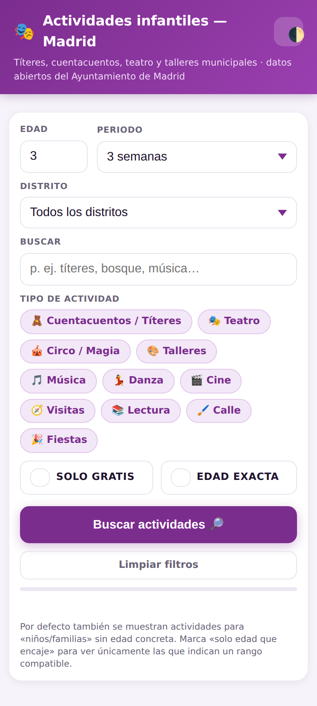
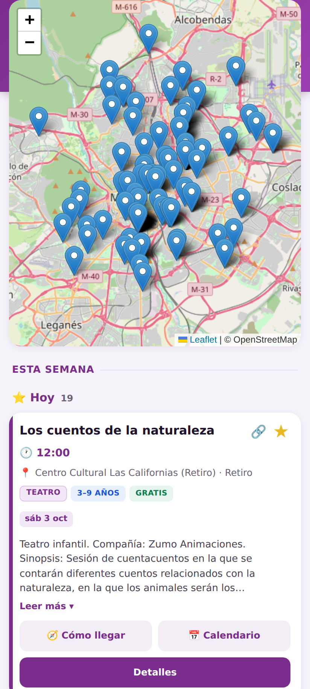
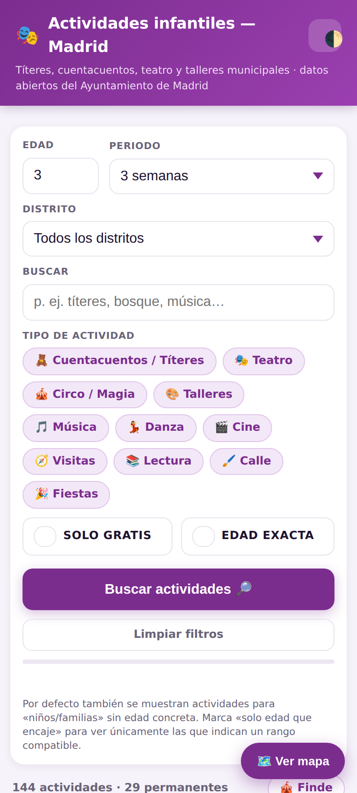
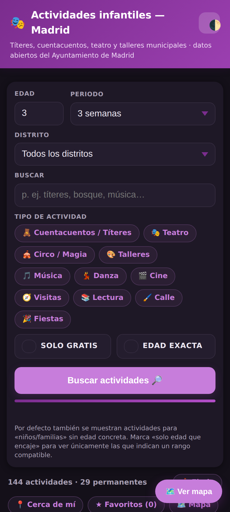

# Actividades infantiles — Madrid 🎭

Finds children's cultural activities (títeres, cuentacuentos, teatro, talleres,
circo…) run by the Ayuntamiento de Madrid, filtered by your child's age and the
weeks ahead you want to plan.

Data source: **Ayuntamiento de Madrid** open data, dataset 206974 —
*"Actividades culturales y de ocio municipal en los próximos 100 días"*
(CC BY 4.0, no API key, updated daily). It aggregates events from centros
culturales, socioculturales, bibliotecas, museos and Juntas de Distrito.

## Screenshots

| Search & filters | Map |
| --- | --- |
|  |  |

| Results | Dark mode |
| --- | --- |
|  |  |

## Run

Double-click `start.bat` (Windows), or from WSL:

```bash
cd /mnt/c/Users/enddooa/madrid-kids
node server.js
```

Then open http://localhost:8788/ . On your phone (same Wi‑Fi) use
`http://<this-PC-IP>:8788/`.

## How it works

- `server.js` — tiny Node server: serves the page and `POST /api/search`,
  which spawns `scrape.py` and streams newline-delimited JSON
  (`progress` lines, then one `result`).
- `scrape.py` — fetches & caches the agenda feed (12 h TTL), then filters by:
  - **age** — parses age ranges from the title/description
    (`de 3 a 6 años`, `a partir de 4 años`, `X meses`→bebés…). Activities with
    no stated age but a `Niños`/`Familias` audience are kept and shown as
    *"edad n/d"* (toggle *"Solo con edad indicada"* to hide them).
  - **weeks** — current week + N following weeks (Mon–Sun). Expands recurring
    and multi-day events into concrete dates, honouring `excluded-days`.
  - **category** — curated kid categories (cuentacuentos/títeres, teatro,
    talleres, circo/magia, cine, música, danza, visitas, fiestas…).
- Results are ranked so what you asked for (títeres, cuentacuentos, teatro,
  circo) floats to the top. Long-running *standing programmes* (season
  programs, permanent book-swap points) are separated into a collapsible
  section so they don't crowd out datable outings.

## Features (frontend)

- **Mobile-first** layout: sticky header, large touch targets, no horizontal
  overflow.
- **Fast first load**: ~40 KB / ~3 requests (≈365 ms on Fast 3G). The map
  library (Leaflet, ~160 KB) is **lazy-loaded** only when you open the map.
- **Dark mode**: follows the system theme automatically; a header button
  cycles auto → light → dark and remembers your choice.
- **Installable PWA**: web manifest + service worker, plus an in-app
  "Añadir a inicio" prompt. Add to the Android home screen; the app shell
  loads offline (stale-while-revalidate) while live search always hits the
  network.
- Results grouped **by day** with friendly labels (⭐ Hoy, 🔜 Mañana, weekday).
- Rich activity cards: prominent time, venue + district, age/price tags,
  one-tap **🧭 Cómo llegar** (Google Maps directions), **📅 Calendario**
  (add to Google Calendar), **🔗 Compartir** (native share sheet / clipboard),
  and a **★ favorite** toggle.
- **📍 Cerca de mí**: one tap uses the phone's GPS to sort activities
  nearest-first and show the distance on each card.
- **🎪 Finde**: one-tap filter to show only Saturday/Sunday activities.
- **Favorites** (★) saved in `localStorage`, with a "solo favoritos" filter.
- **District filter** populated from the current results.
- **Limpiar filtros** button resets everything to defaults in one tap.
- **Remembers your last search** (age, period, categories, filters) and
  auto-runs it on next open — ideal once installed on the home screen.
- **Collapsible map** (Leaflet) with a pin per activity; hidden by default so
  it never crowds the list on a phone.
- **Accessible**: all controls are real buttons with `aria-pressed`/labels,
  visible keyboard focus rings, `lang=es`, and a live-region result count.
- Skeleton loading state and graceful empty/error states.

## Testing

Automated checks live in `test/`:

```bash
npm run lint:js   # parse-check the inline JS
npm test          # headless Chrome E2E: real search, cards, favorites,
                  # district filter, map pins, mobile-overflow, no JS errors
npm run test:api  # exercise the Python backend across many job shapes
```

`npm test` drives the real page in a 412×915 mobile viewport via
`puppeteer-core` + system Chrome, and writes screenshots to `test/shots/`.
The backend coerces bad input (e.g. non-numeric age) to safe defaults instead
of crashing.

## Config

- Port: `PORT=8788` (env var).
- Cache lives in `cache/agenda.json`; delete it to force a fresh fetch.

## Dependencies

- Runtime: Python venv with `curl_cffi` (falls back to `requests`), Node ≥ 18.
- Dev/test only: `puppeteer-core` + a system Chrome at `/usr/bin/google-chrome`.
